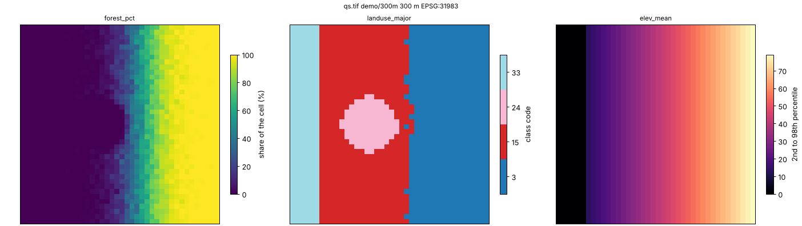

# DisSCube

**Model-ready grids from heterogeneous raster and vector sources, declared in one TOML file.**

You say which grid you want, which sources feed it and which variables to derive. DisSCube checks the file, fetches
the data, aligns everything to the grid and gives back the variables, with the provenance of every number. It is the
data-preparation step of the **DisSModel** ecosystem, and the counterpart of TerraME's `fill`.

```bash
pip install disscube
disscube validate pipeline.toml     # check the file; nothing is downloaded
disscube run pipeline.toml -o cube.tif
```

---

## One file describes the whole preparation

```toml
schema = 1
name = "Quickstart"

[grid]                                   # where: a 300 m grid
name = "demo/300m"
crs = "EPSG:31983"
bbox = [570000.0, 9708000.0, 582000.0, 9720000.0]
resolution = 300

[[source]]                               # from what: files, MapBiomas, BDC, OSM…
id = "landuse"
type = "file"
path = "../data/quickstart/landuse.tif"
crs = "EPSG:31983"

[[source]]
id = "elevation"
type = "file"
path = "../data/quickstart/elevation.tif"
crs = "EPSG:31983"

[[derive]]                               # which variables: one block each
target = "forest_pct"
source = "landuse"
operator = "percentage"
class_code = 3

[[derive]]
target = "landuse_major"
source = "landuse"
operator = "majority"

[[derive]]
target = "elev_mean"
source = "elevation"
operator = "mean"
```

The file is the experiment: it can be versioned, reviewed and re-run, and a change in any line changes the
fingerprint (`spec_hash`) of the variables it affects. This is `examples/pipelines/quickstart.toml`, which runs offline on the
synthetic data of the repository.

**Several years?** One block with `years = [2000, 2020]` and an `id = "lulc_{year}"` makes one source per year, and the
derivations that use `{year}` make one variable per year. See [Pipeline files (TOML)](guides/pipeline_files.md).

---

## The commands

| Command | What it does |
|---|---|
| `disscube validate FILE` | checks the file and prints the plan, before any download |
| `disscube fetch FILE` | downloads the remote sources and checks their SHA-256 |
| `disscube run FILE` | fetches, aligns and derives; with `-o OUT` also exports a GeoTIFF or netCDF |
| `disscube export FILE -o OUT` | exports variables from a workspace that already has them |
| `disscube plot OUT.tif` | a quick look at the bands, as a PNG |

```bash
disscube validate examples/pipelines/quickstart.toml
disscube run      examples/pipelines/quickstart.toml --workspace outputs/quickstart -o outputs/quickstart.tif
disscube plot     outputs/quickstart.tif --cols 3
```



Every option is in the [command-line reference](guides/cli.md). Errors exit with status 2 and `--json` gives the
report in a machine-readable form, so a pipeline runs in a script or in CI as it does on a laptop.

---

## What you get

- **The variables**, one band per variable and year in the exported GeoTIFF (or netCDF), aligned to your grid.
- **A workspace** with the catalog, the stored variables and `run.json`: the sources with their checksums, the
  fingerprint of each derivation, the times, and the file that produced it. Rerunning only redoes what changed.
- **Large sources without large memory.** National rasters are read in blocks, so the peak memory depends on the
  block and not on the source: MapBiomas for all of Brazil at 5 km ran in under two hours with 3.9 GB
  ([block-wise reading](guides/blocks.md)).

---

## Sources in, one value per cell out

**Sources** (`type`): `file` (a raster, a vector layer or a shapefile in a zip), `mapbiomas` and `prodes` (national
land-cover maps), `bdc` (Brazil Data Cube, over STAC), `classified` (a classified map with its legend), `osm`
(OpenStreetMap), `dem` (elevation and slope) and `union` (several vector sources as one).

**Operators** summarise a source in each cell:

- statistics of a raster: `mean`, `median`, `min`, `max`, `std`, `sum`
- classes: `percentage`, `majority`, `minority` (with `groups`, to read leaf classes at level 1)
- vector layers: `distance`, `min_distance`, `count`, `presence`, `area`, `attribute`
- road networks: `network_cost` (also `gpm_network`)

The sources are in the [pipeline files guide](guides/pipeline_files.md#source-types), and the operators in
[Operator System](architecture/operators.md). From TerraME's `fill`, each operation has a counterpart, measured in
[TerraME Fill Cells Correspondence](terrame_fill_correspondence.md).

---

## Hand the cube to a model

The workspace opens as a cube in Python, and `disscube[dissmodel]` hands it to a DisSModel model:

```python
from disscube import CubeClient

cube = CubeClient(catalog="outputs/quickstart/catalog.db", store="outputs/quickstart/store/")
ds = cube.to_dataset(["forest_pct", "elev_mean"], grid_id="demo/300m")                  # xarray.Dataset
backend = cube.to_raster_backend(["forest_pct", "landuse_major"], grid_id="demo/300m")  # a DisSModel RasterBackend
```

```bash
pip install "disscube[dissmodel]"     # + the hand-off to DisSModel
pip install "disscube[plot]"          # + disscube plot
```

The same operations are available as a Python API (`CubeClient`, `Derivation`) for what does not fit in a file: see
[Examples](examples.md).

---

## Where to go next

- **[Examples](examples.md)**: the quickstart pipeline and the Python API on synthetic data, then real study areas
- **[Pipeline files (TOML)](guides/pipeline_files.md)**: the format, the source types, the operator options
- **[Command line](guides/cli.md)** and **[Block-wise reading](guides/blocks.md)**
- **Sources**: [MapBiomas](guides/mapbiomas.md), [PRODES and SITS](guides/landcover.md), [Brazil Data Cube](guides/bdc.md), [OpenStreetMap](guides/osm.md), [elevation and slope](guides/dem.md)
- **[Architecture](architecture/overview.md)**: the model, the stages and the reproducibility hash

---

## The DisSModel ecosystem

| Package | Role | Documentation |
|:---|:---|:---|
| [**dissmodel**](https://github.com/DisSModel/dissmodel) | Core framework: clock, spatial substrates, executor, I/O, visualization | [dissmodel.github.io/dissmodel](https://dissmodel.github.io/dissmodel/) |
| [**disscube**](https://github.com/DisSModel/disscube) | Declarative pipelines that turn raster and vector sources into model-ready grids | [dissmodel.github.io/disscube](https://dissmodel.github.io/disscube/) |
| [**disslucc**](https://github.com/DisSModel/disslucc) | Land use and cover change: demand, potential and allocation | [dissmodel.github.io/disslucc](https://dissmodel.github.io/disslucc/) |
| [dissmodel-ca](https://github.com/DisSModel/dissmodel-ca), [dissmodel-sysdyn](https://github.com/DisSModel/dissmodel-sysdyn), [dissmodel-abm](https://github.com/DisSModel/dissmodel-abm) | Ready-to-use cellular automata, system dynamics and agent-based models | GitHub |

Developed by the [LambdaGeo](https://github.com/LambdaGeo) group at the Federal University of Maranhão (UFMA). MIT licence.
